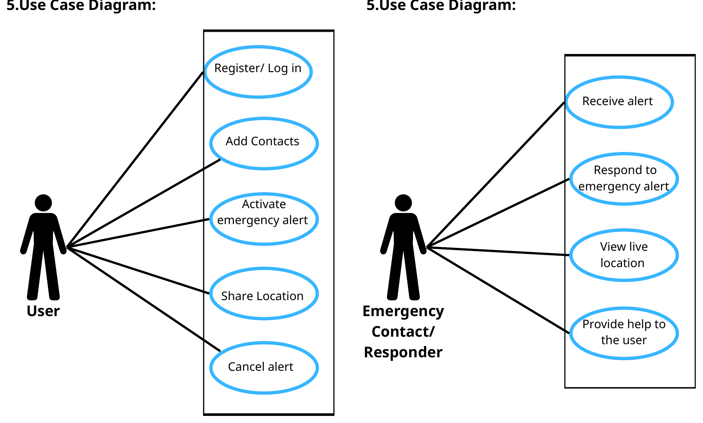
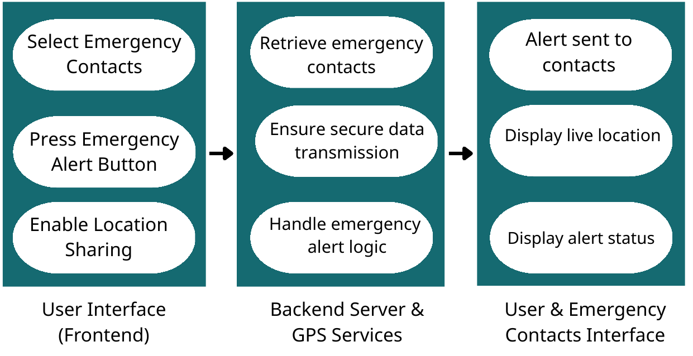
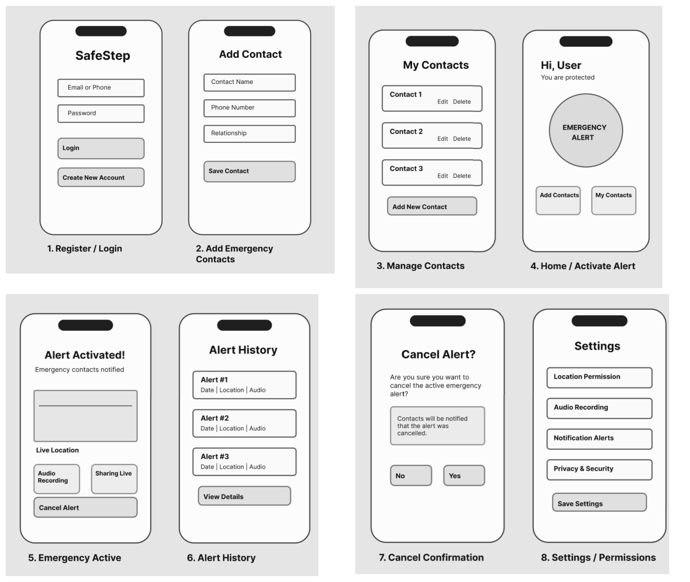
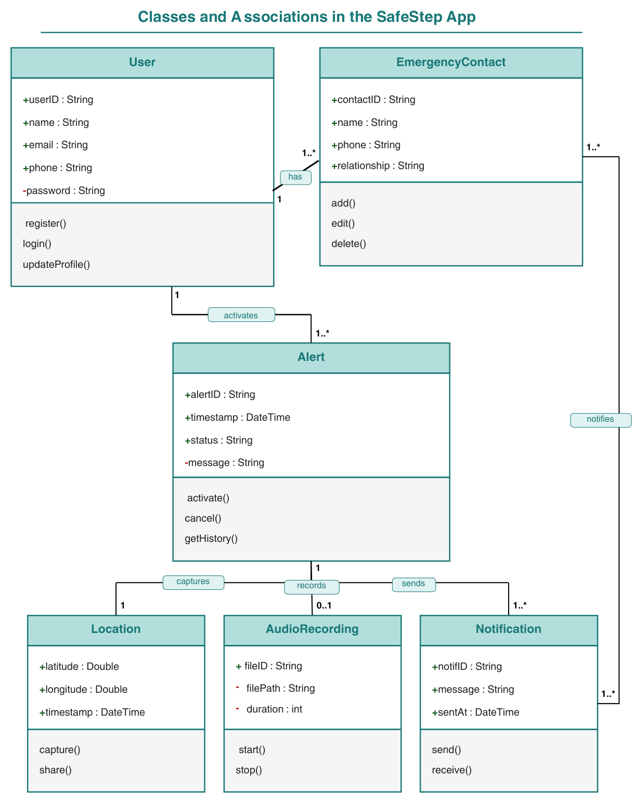

# 🛡️ SafeStep — Women's Safety Mobile App (Software Engineering Project)

**SafeStep** is a mobile application concept that helps women request help instantly in an emergency. With **one tap**, the app alerts trusted contacts, shares the user's **live GPS location**, and starts **audio recording** as evidence.

This repository documents the full **software development lifecycle** of the project — planning, requirements analysis, design and testing — completed as a university team project at Umm Al-Qura University.

📄 Full report: [SafeStep_Report.pdf](SafeStep_Report.pdf)

---

## ❗ Problem Statement

Traditional emergency calls require several steps — unlocking the phone, dialing and explaining the location — which may be impossible when someone is under threat or in shock. Many existing safety apps are too complex for fast use or lack automatic evidence collection and real-time location sharing. SafeStep aims to provide an **instant, discreet and reliable** way to reach trusted contacts.

---

## 🗓️ Lifecycle Overview

| Stage | Deliverables |
|---|---|
| **Planning** | Project idea, problem statement, scope, timeline |
| **Analysis** | Functional & non-functional requirements (IEEE 830 style), user personas, use case diagrams, risk analysis |
| **Design** | Software architecture, UI mockups, UML class diagram |
| **Testing** | Test scenarios, test cases, bug report |

**Project timeline:** Weeks 3–5 planning & requirements · Weeks 6–7 system structure · Weeks 8–10 development · Weeks 11–15 system review & documentation

---

## 📋 Requirements

### Functional Requirements
Each requirement is specified with *Action, Requirements, Pre-condition, Post-condition and Side effects*.

| # | Requirement |
|---|---|
| FR1 | User registration and login |
| FR2 | Manage emergency contacts (add / edit / delete) |
| FR3 | Activate emergency alert with one button |
| FR4 | Share live GPS location |
| FR5 | Automatic audio recording during an alert |
| FR6 | Cancel an accidental alert |
| FR7 | View alert history |

### Non-Functional Requirements
Security & privacy · Performance · Usability · Reliability · Availability (24/7) · Location accuracy · Compatibility (Android & iOS)

### User Personas
Four personas guided the design: an employee commuting between locations, a university student leaving campus at night, a nurse working late shifts, and a professor leaving campus late.

---

## 🧩 Use Case Diagram

Two actors: the **User** and the **Emergency Contact / Responder**.

---

## ⚠️ Risks & Mitigations

| Risk | Mitigation |
|---|---|
| Data privacy (location & contacts leakage) | End-to-end encryption and data-protection standards (e.g. GDPR) |
| System availability | High-availability cloud services and offline basic alert triggering |
| GPS accuracy indoors | Multi-source positioning (Wi-Fi, cell towers + GPS) |
| False alarms | Short countdown before sending, biometric cancel option |
| Battery consumption | Low-power mode; high-precision tracking only during alerts |
| Responder not noticing | Critical alerts that bypass silent mode |

---

## 🏗️ Software Architecture

Input (frontend) → Process (backend server & GPS services) → Output (user & emergency contacts interface)

---

## 📱 UI Mockups

Eight screens: Register/Login, Add Contact, Manage Contacts, Home (emergency button), Emergency Active, Alert History, Cancel Confirmation, Settings/Permissions.

---

## 🧱 UML Class Diagram

Classes: `User`, `EmergencyContact`, `Alert`, `Location`, `AudioRecording`, `Notification` — with their attributes, methods, associations and multiplicities.

---

## 🧪 Testing

| Test Case | Scenario | Result |
|---|---|---|
| TC01 | Create a new account successfully | ✅ Pass |
| TC02 | Emergency alert notification is sent to contacts | ✅ Pass |
| TC03 | Handle failure when location services are disabled | ✅ Pass |
| TC04 | Validate missing emergency contact information | ❌ Fail |

A bug report (**B01 — Emergency alert notification not sent**) documents the steps to reproduce, expected vs actual results and severity.

---

## 🛠️ Skills Demonstrated

- Requirements engineering following **IEEE 830** structure
- UML modeling: **use case** and **class** diagrams
- Risk analysis and mitigation planning
- UI/UX wireframing
- Test scenario & test case design, bug reporting
- Teamwork across the full software development lifecycle

---

## 👥 Team

- Layan Salem Althubaiti
- Wajd Sameer Al-Luhaybi
- Raghad Ghazi Almatrafi
- Jumana Naif Almatrafi

Umm Al-Qura University
